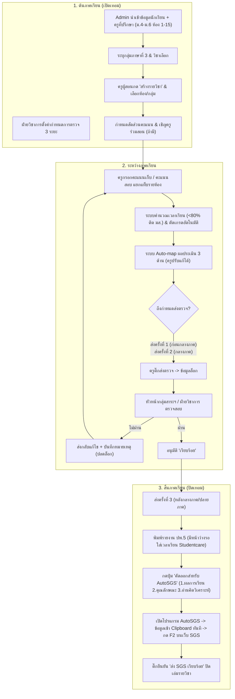
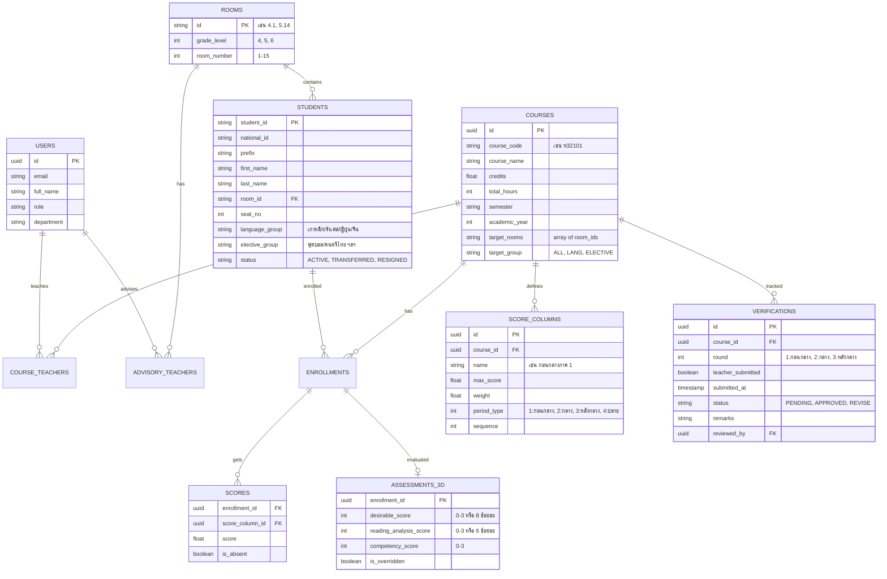

# 📋 แผนสถาปัตยกรรมและข้อกำหนดความต้องการระบบ NewTEA
### (Triam Evaluation and Assessment - ระบบบันทึกผลการเรียนประจำรายวิชา)
**โรงเรียนเตรียมอุดมศึกษาภาคเหนือ (TUNorth)**

---

## 🎯 Goal Description
พัฒนาระบบ **NewTEA (Triam Evaluation and Assessment)** ในรูปแบบ **Full-Stack Web Application** เพื่อทดแทนการทำงานเดิมที่ครูผู้สอนต้องคัดลอกไฟล์ Google Sheet แยกรายวิชา โดยระบบใหม่จะรวมศูนย์ข้อมูลการวัดและประเมินผลการเรียน จัดการกลุ่มนักเรียนที่ซับซ้อน (ระดับชั้น ม.4 - ม.6 รวม 45 ห้อง, กลุ่มภาษาที่ 3, กลุ่มวิชาเลือก), รองรับการร่วมสอน (Co-teaching), มีระบบตัดเกรดและประเมิน 3 ด้านอัตโนมัติ, ระบบติดตามการส่งตรวจ 3 ระยะพร้อมล็อกข้อมูล, พิมพ์เอกสาร ปพ.5 สมบูรณ์แบบ, และมีปุ่มคัดลอกข้อมูลสำหรับเชื่อมต่อกับโปรแกรม **AutoSGS** (`D:\TUNorth\apps\sgs`) แบบ 1-Click

---

## 👥 User Roles & Permissions Matrix

| บทบาท (Role) | สิทธิ์และความรับผิดชอบในระบบ |
| :--- | :--- |
| **Admin (ผู้ดูแลระบบ)** | • จัดการปีการศึกษา/ภาคเรียน<br>• นำเข้า (Import) ข้อมูลนักเรียน, ครูที่ปรึกษา (1-3 คน/ห้อง), และรายชื่อวิชา<br>• จัดการสถานะนักเรียน (ย้ายห้อง, ย้ายสาย, ลาออก, ย้ายโรงเรียน)<br>• กำหนดช่วงเวลา/เดดไลน์การส่งตรวจ 3 ระยะ |
| **Teacher (ครูผู้สอน)** | • เพิ่ม/สร้างวิชาที่ตนสอน เลือกระดับชั้น/ห้อง/กลุ่มวิชาเลือก/กลุ่มภาษา และเชิญครูร่วมสอน (Co-teachers)<br>• ตั้งค่าน้ำหนักคะแนนและช่องคะแนนเก็บได้อย่างอิสระ<br>• บันทึกเวลาเรียน และคะแนนเก็บ/สอบ แยกตามแท็บห้องเรียน (`4.1`, `4.2`, ...)<br>• ปรับแก้ผลการประเมิน 3 ด้าน (ระบบคำนวณตั้งต้นให้อัตโนมัติ)<br>• ส่งตรวจตามกำหนดเวลา (ระบบล็อกหลังส่ง)<br>• พิมพ์เอกสาร ปพ.5 และกดคัดลอกข้อมูลสำหรับ **AutoSGS** |
| **Department Head (หัวหน้ากลุ่มสาระฯ)** | • ตรวจสอบความถูกต้องของคะแนนและเกณฑ์การประเมินในกลุ่มสาระฯ ของตน<br>• อนุมัติ ("เรียบร้อย") หรือส่งกลับให้แก้ไข ("แก้ไข") พร้อมระบุหมายเหตุ/ข้อเสนอแนะ |
| **Academic Affairs (ฝ่ายวิชาการ)** | • ตรวจสอบภาพรวมทั้งโรงเรียนผ่านแดชบอร์ดติดตามแบบเรียลไทม์ (ทดแทน Sheet ตรวจคะแนน TEA68)<br>• รับรองผลการเรียนขั้นสุดท้าย ปลดล็อกแก้ไขกรณีพิเศษ<br>• ตรวจสอบสถานะการนำคะแนนขึ้น SGS |
| **Advisory Teacher (ครูที่ปรึกษา)** | • ดูรายงานผลการเรียน สถิติ และการติด 0, ร, มส ของนักเรียนในห้องที่ตนเป็นที่ปรึกษา |

---

## 🔄 User Journey & Workflow (ตั้งแต่เปิดเทอมจนถึงสิ้นเทอม)



---

## 🏗️ System Architecture & Tech Stack

ตามโครงสร้างเซิร์ฟเวอร์มาตรฐานของโรงเรียนที่ระบุใน [DEPLOYMENT_GUIDE.md](file:///D:/TUNorth/DEPLOYMENT_GUIDE.md):

```text
[ ผู้ใช้งาน / คุณครู 100-150 คน ]
           │
           ▼
┌────────────────────────────────────────────────────────┐
│ Cloudflare Tunnel / Local Nginx Proxy (Port 8010)       │
└──────────────────────────┬─────────────────────────────┘
                           │
                           ▼
┌────────────────────────────────────────────────────────┐
│ Docker Network: tunorth-net                            │
│                                                        │
│  ┌─────────────────────────┐  ┌─────────────────────┐  │
│  │ Frontend: tea-frontend  │  │ Backend: tea-backend│  │
│  │ (Next.js 16 + React 19) │◄─┤ (Go 1.26 + Fiber)   │  │
│  │ Port: 3000 (Bun engine) │  │ Port: 8080 (Air)    │  │
│  └─────────────────────────┘  └──────────┬──────────┘  │
│                                          │ (GORM)      │
│                                          ▼             │
│                               ┌─────────────────────┐  │
│                               │ Database: tea-db    │  │
│                               │ PostgreSQL 17       │  │
│                               │ db: tunorth-tea_db  │  │
│                               └─────────────────────┘  │
└────────────────────────────────────────────────────────┘
```

### 1. Frontend Layer
- **Framework:** Next.js 16 (App Router) + React 19
- **Language:** TypeScript 5
- **Package Manager:** **Bun** (ห้ามใช้ npm/npx ตามข้อกำหนด)
- **UI Components & Styling:** Tailwind CSS + Shadcn UI (Radix UI) + Lucide Icons + Sonner (Toasts)
- **State Management:** Zustand
- **Gradebook Grid Engine:** TanStack Table v8 พร้อม Virtualization สำหรับตารางคะแนนขนาดใหญ่ รองรับ Keyboard Navigation (กด Enter/Tab เลื่อนเซลล์แบบ Excel)
- **Clipboard Utility:** Web Clipboard API จัดฟอร์แมตข้อมูล Tab-separated ตรงตาม AutoSGS 3 โหมด

### 2. Backend Layer
- **Language & Framework:** Go 1.26 + Fiber
- **Live Reload:** Air
- **ORM:** GORM
- **Calculation Engine:** Pure TypeScript Calculation Engine (บน Client สำหรับคำนวณแบบ Real-time ทันทีที่กรอก) และ Go Calculation Verification Engine (บน Server ป้องกันข้อมูลผิดพลาด)
- **Data Validation:** Zod (บน Client/API Contracts)

### 3. Database Layer
- **Database Engine:** PostgreSQL 17 (Production ใน Docker Container `tea-db`)
- **Database Name:** `tunorth-tea_db`
- **Volume Mount:** `D:\TUNorth\data\postgres\tea` หรือตามโครงสร้าง Server

### 4. Authentication & Security Layer
- **Auth Engine:** Better Auth
- **Login Methods:**
  1. Google Workspace SSO (@tn.ac.th)
  2. Username / Password (กรณีครูพิเศษ/เข้าใช้งานฉุกเฉิน)
- **RBAC (Role-Based Access Control):** Admin, Teacher, Dept Head, Academic, Advisor

---

## 📊 Core Data Model (Schema Design)



---

## ⚡ AutoSGS Integration Specifications (`D:\TUNorth\apps\sgs`)

ในหน้า Gradebook จะมีเมนู Quick Export สำหรับ **AutoSGS** 3 โหมด โดยทำการจัดชุดข้อมูลลง System Clipboard ผ่านปุ่มกด:

1. **โหมดที่ 1: ผลการเรียน (Grade Mode)**
   - รูปแบบ: เรียงตามแถวนักเรียน ลำดับคะแนนคอลัมน์ $1 \dots n$ คั่นด้วย `\t` (Tab) และขึ้นบรรทัดใหม่ด้วย `\n`
   - เมื่อครูกดปุ่ม -> AutoSGS ตรวจพบ Clipboard ทันที -> ครูสลับไปหน้า SGS กด `F2` -> โปรแกรมพิมพ์คะแนนลงทีละช่องพร้อมกด Tab ข้ามอัตโนมัติ
2. **โหมดที่ 2: คุณลักษณะอันพึงประสงค์ (8 คอลัมน์)**
   - รูปแบบ: ค่าคะแนน 8 คอลัมน์ย่อยตามเกณฑ์มาตรฐาน สพฐ. คั่นด้วย `\t`
   - AutoSGS จัดการกด Tab เพิ่มอีก 4 ครั้งท้ายแถว เพื่อเลื่อนไปคนถัดไปอัตโนมัติตาม Logic เดิมใน `autosgs`
3. **โหมดที่ 3: การอ่าน คิดวิเคราะห์และเขียน (6 คอลัมน์)**
   - รูปแบบ: ค่าคะแนน 6 คอลัมน์ย่อย คั่นด้วย `\t`
   - AutoSGS จัดการกด Tab เพิ่มอีก 2 ครั้งท้ายแถว ข้ามไปคนถัดไปอัตโนมัติ

---

## 📄 ปพ.5 Report Export Structure (PDF)

เมื่อสิ้นภาคเรียน ระบบจะ Compile เอกสาร ปพ.5 ประกอบด้วย 7 องค์ประกอบ:
1. **หน้าปก:** ตราโรงเรียนเตรียมอุดมศึกษาภาคเหนือ, รายวิชา, รหัสวิชา, กลุ่มสาระฯ, ภาคเรียน/ปีการศึกษา, ชื่อครูผู้สอน
2. **คำอธิบายรายวิชา (Course Description):** ข้อความคำอธิบายรายวิชาและตัวชี้วัด/ผลการเรียนรู้
3. **โครงสร้างรายวิชา & เกณฑ์การให้คะแนน:** หน่วยการเรียนรู้, อัตราส่วนคะแนนก่อนกลางภาค : กลางภาค : หลังกลางภาค : ปลายภาค
4. **บันทึกเวลาเรียน:** *หน้าคั่น/หน้าว่างเว้นไว้* เพื่อนำไปแนบรวมกับรายงานเวลาเรียนที่ Export จากระบบ Studentcare
5. **ตารางคะแนนรวมและผลการเรียน:** รายชื่อนักเรียน, คะแนนเก็บทุกช่อง, คะแนนสอบ, รวม 100 คะแนน, ผลการเรียน (0 - 4 / ร / มส)
6. **การประเมิน 3 ด้าน:** ตารางสรุปผลการประเมินคุณลักษณะอันพึงประสงค์, การอ่านคิดวิเคราะห์ฯ, และสมรรถนะสำคัญ
7. **หน้าสรุปผลและลงนามอนุมัติ (Sign-off):** กราฟ/สถิติการกระจายของเกรด, ช่องลงนามครูผู้สอน, หัวหน้ากลุ่มสาระฯ, หัวหน้างานวัดผล, รองผู้อำนวยการฝ่ายวิชาการ และผู้อำนวยการโรงเรียน

---

## 🚀 Verification Plan

### Automated Tests
1. **Grading & Calculation Unit Tests:**
   - ทดสอบเกณฑ์คะแนน $0 - 100$ ตัดเกรด $0, 1, 1.5, 2, 2.5, 3, 3.5, 4$ ถูกต้องแม่นยำ $100\%$
   - ทดสอบเงื่อนไขเวลาเรียน $< 80\%$ ติดสถานะ "มส" อัตโนมัติ
   - ทดสอบเกณฑ์ Auto-mapping การประเมิน 3 ด้านตามช่วงคะแนน
2. **AutoSGS Clipboard Formatting Tests:**
   - ตรวจสอบ string output ของแต่ละโหมดว่าคั่นด้วย Tab (`\t`) และบรรทัด (`\r\n` / `\n`) ตรงกับ format ที่ `autosgs/core.py` ตรวจรับ
3. **API & Workflow Lock Tests:**
   - ทดสอบการล็อกสิทธิ์: เมื่อส่งตรวจแล้ว API ปฏิเสธคำขอแก้ไขคะแนน (HTTP 403 / 423 Locked) จนกว่าจะถูก Reject

### Manual Verification
1. **Excel/CSV Master Data Import:** อัปโหลดไฟล์นักเรียน ม.4-ม.6 ตรวจสอบการแยกกลุ่มภาษาและกลุ่มวิชาเลือก
2. **Interactive Gradebook UI:** ทดสอบการพิมพ์คะแนนด้วยปุ่มลูกศร/Enter/Tab บนหน้าเว็บ ปรับเปลี่ยนสัดส่วนคะแนน
3. **End-to-End AutoSGS Sync:** เปิดโปรแกรม AutoSGS ควบคู่ กดปุ่ม Copy บนหน้าเว็บ แล้วทดสอบการพิมพ์จริง
4. **ปพ.5 PDF Rendering:** ตรวจสอบความถูกต้องของหน้าเอกสาร ปพ.5 ทุกหน้าก่อนพิมพ์
